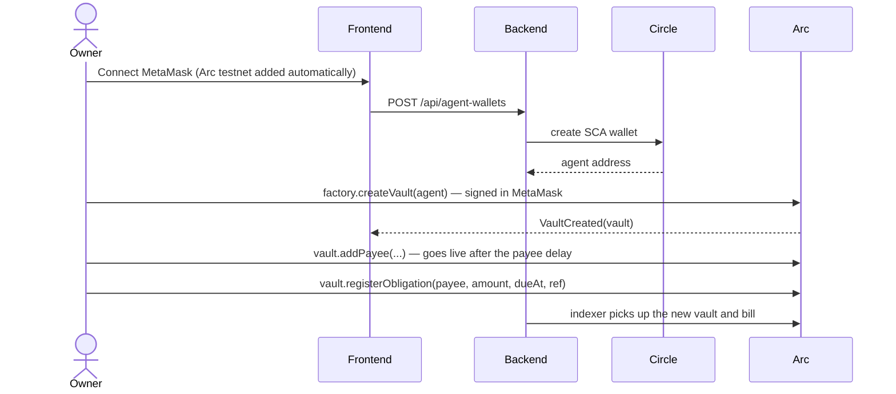
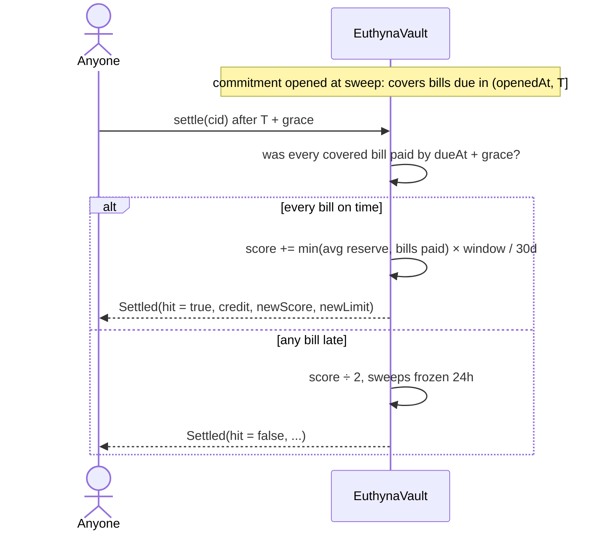

# Euthyna — An AI treasurer on probation

> **Tameion Agents Hackathon — Canteen × Circle, on Arc**
>
> *An AI agent that pays a small business's bills in USDC, whose spending limit lives in a smart contract
> and moves only with its own on-chain track record. Trust is earned, never configured.*

**Live app:** [euthynax.vercel.app](https://euthynax.vercel.app) ·
**Pitch:** [/pitch](https://euthynax.vercel.app/pitch) ·
**Docs:** [/docs](https://euthynax.vercel.app/docs) ·
**API:** [euthyna-np2i.onrender.com/api/stats](https://euthyna-np2i.onrender.com/api/stats)

---

## Deployed contracts

### Arc testnet (chain 5042002)

| Contract | Address |
|---|---|
| Production factory | [`0xD6846FB7BAD7F8CDba6eE8fB4b42D4e16A30d658`](https://testnet.arcscan.app/address/0xD6846FB7BAD7F8CDba6eE8fB4b42D4e16A30d658) |
| Production vault ("Euthyna") | [`0x0767f13610b794f1de85CEe78728114df1Ffa23d`](https://testnet.arcscan.app/address/0x0767f13610b794f1de85CEe78728114df1Ffa23d) |
| Second vault ("Euthyna Infra & API Costs") | [`0xc5A7E94bd82a479Da2AFaa65B2147666f4Abf142`](https://testnet.arcscan.app/address/0xc5A7E94bd82a479Da2AFaa65B2147666f4Abf142) |
| Test factory (short parameters) | [`0xffe19C5eBb3A8c70546B4bD033f54e89dc807438`](https://testnet.arcscan.app/address/0xffe19C5eBb3A8c70546B4bD033f54e89dc807438) |
| Test vault with the settled hit | [`0x4a08A58be01B5311D36EF4b042AA83BF738cF2b5`](https://testnet.arcscan.app/address/0x4a08A58be01B5311D36EF4b042AA83BF738cF2b5) |
| USDC (Arc native) | `0x3600000000000000000000000000000000000000` |

> Explorer: [testnet.arcscan.app](https://testnet.arcscan.app). Contracts are verified; deployment records are
> in `contract/broadcast/`.

---

## 1. What is Euthyna?

Euthyna is a treasury agent for small businesses on Arc. It pays bills, keeps enough cash on hand for what's
coming due, and parks the rest in a reserve. What makes it different is **how much it's allowed to spend**:
that limit isn't a setting. It lives in the vault contract and moves only when the agent proves, on-chain,
that it kept its promises.

```
ONBOARD  →  The owner creates a vault, approves payees and registers bills (3 wallet signatures)
DECIDE   →  The agent snapshots the vault; code computes every number; an LLM proposes; policy checks
PAY      →  Bills are paid on time from the agent's Circle wallet, with a decision hash on-chain
COMMIT   →  Parking idle cash is a falsifiable promise: "every bill due before T is paid on time"
SETTLE   →  After T + grace, anyone calls settle(); the contract grades the promise from its own records
EARN     →  A hit raises the score and the autonomous limit; a miss halves the score
```

The name comes from the *euthyna*, the audit an Athenian official faced on leaving office: you held power,
now show your record.

---

## 2. The problem

**A limit is just a number someone typed.** AI agents get a spending limit from a config file. Nothing ties
it to how well the agent actually performs.

**Trust is all or nothing.** You either hand an agent the keys or have a human approve every payment. There's
no probation, no way to start small and grow, the way you would with a new hire.

**Agents grade their own homework.** Performance claims come from logs and dashboards the operator controls.
Nobody outside can check them.

Today, letting an AI agent move a business's money is a leap of faith, and the business carries all of the
risk.

---

## 3. The solution

Euthyna makes trust a **contract-enforced track record**.

| Piece | What it does |
|---|---|
| **Owner's vault** | USDC, payees and bills live in a contract the owner controls. The agent acts only through it. |
| **Allowlist only** | The agent has no function that sends money to an address of its choosing. New payees wait an hour before they can be paid. |
| **Every saving is a promise** | `sweep()` moves idle cash to reserve and opens a commitment: every bill due before `T` will be paid on time from liquid cash. |
| **Graded by the contract** | `settle()` is permissionless. After `T + grace` the contract checks its own records: hit or miss. |
| **Limit = track record** | `autonomousLimit = min(ownerCeiling, baseLimit + rate × score)`. A hit adds to the score linearly; a miss halves it and freezes sweeps for 24 hours. |
| **Every decision replayable** | The full decision record is hashed (keccak256) before any money moves, and the hash goes on-chain with the action. Anyone can re-hash it in their browser. |

**The model proposes, code checks every number, and the contract has the final word.**

### Scoring

| | |
|---|---|
| Autonomous limit | `min(ownerCeiling, baseLimit + rate × score)`; a new vault starts at 25 USDC |
| Daily cap | `min(ownerDailyCeiling, 3 × limit)` |
| Hit | `score += min(avg reserve held, owner bills paid on time in window) × window / 30 days` |
| Miss | `score ÷ 2`, sweeps frozen for 24 hours |
| Bills over the limit | escalated to the owner, who approves (paid from the vault) or cancels |

---

## 4. What makes it different

| | Pays bills itself | Limit enforced on-chain | Limit earned from results | Graded by a contract | Decisions replayable |
|---|---|---|---|---|---|
| AI payment agents | ✅ | — | — | — | — |
| Fixed spending caps (multisig, policy rules) | — | ✅ | fixed | — | — |
| Off-chain agent ratings | — | — | self-reported | — | — |
| **Euthyna** | ✅ | ✅ | ✅ | ✅ | ✅ |

- **Earned, not configured.** The only thing that raises the limit is a promise kept, checked by the contract.
- **Lost faster than earned.** Hits add a little; one miss halves the score. A reckless agent shrinks quickly.
- **Anyone can audit it.** `settle()` is permissionless and every decision hash is on-chain.
- **Closed loopholes.** The spec's 22 attacks (prompt injection, the agent adding payees, sweep-then-redeem,
  the agent writing its own exam, and more) are each closed in the contract or the policy layer; see the
  [loophole audit](docs/contract.md#loophole-audit).

---

## 5. How Arc and Circle power Euthyna

### Arc

| Feature | How Euthyna uses it |
|---|---|
| **USDC as gas** | Fees, bills and reserve are all USDC, so even small bills are cheap to pay and settle |
| **Fast finality** | Payments and settlements confirm quickly enough for the agent to act and verify in one run |
| **Arc USDC (`0x3600…`)** | The vault holds and pays native USDC through its ERC-20 interface |
| **RPC** | `rpc.testnet.arc.io`, with a Blockdaemon fallback and Multicall3-batched reads |

### Circle

| Feature | How Euthyna uses it |
|---|---|
| **Developer-controlled wallets** | Each vault gets its own agent wallet, created by the backend at onboarding |
| **Smart-contract accounts (ERC-4337)** | The agent signs as an SCA; the owner's key never touches the backend |
| **Gas Station** | Agent transactions are gas-sponsored |
| **Idempotency keys** | Each action uses a key derived from (decision id, index), so a retry can never pay twice |
| **Webhook endpoint** | `POST /webhooks/circle` nudges the indexer, so new transactions show up fast |

```typescript
// backend/src/agent.ts — every action carries the decision's hash and a deterministic idempotency key
const data = encodeAction(action, decisionHash); // pay / sweep / redeem / escalate, with decisionHash
const key = actionKey(decisionId, idx);          // uuidv5(`${decisionId}:${idx}`)
const r = await send({ to: vault, data, from: agentAddress, walletId, idempotencyKey: key });
```

---

## 6. Architecture

```
┌──────────────────────────── Owner / Browser ─────────────────────────────┐
│  Next.js 16 frontend (React 19, Tailwind v4)                             │
│  MetaMask (EIP-1193)  ── owner signs addPayee / registerObligation / ... │
│  EIP-191 owner auth   ── signed header for owner-only API routes         │
│  Replay page          ── re-hashes decision records in the browser       │
│  Trust page           ── anyone can call settle() on a matured promise   │
└───────────────────────────────────┬──────────────────────────────────────┘
                                    │ HTTPS + SSE
                                    ▼
┌──────────────────────── Backend (Node + TypeScript) ─────────────────────┐
│  Agent loop    snapshot → precompute → LLM → policy → hash → execute     │
│  Settler       settles matured commitments every 10 min                  │
│  Indexer       mirrors vault + factory events into Postgres              │
│  HTTP API      public reads, owner-signed writes, SSE live stream        │
│  LLM chain     8 free models (Gemini first, OpenRouter fallback)         │
└──────────┬──────────────────────────┬────────────────────────┬──────────┘
           │ Circle W3S API            │ Postgres (Supabase)    │ Arc RPC
           ▼                           ▼                        ▼
┌─────────────────────┐   ┌───────────────────────┐   ┌──────────────────────────┐
│ Agent SCA wallet    │   │ decisions, actions,   │   │ EuthynaFactory           │
│ (ERC-4337, Gas      │──▶│ obligations, payees,  │   │ EuthynaVault (per owner) │
│  Station sponsored) │   │ commitments, events   │   │ USDC                     │
└─────────────────────┘   └───────────────────────┘   └──────────────────────────┘
```

---

## 7. Sequence flows

### Onboarding



### One agent run

```mermaid
sequenceDiagram
    participant Scheduler
    participant Agent as Agent loop
    participant LLM as LLM chain
    participant Policy
    participant Circle
    participant Vault as EuthynaVault

    Scheduler->>Agent: every 30 min, or on a new bill / inflow
    Agent->>Vault: snapshot (balances, bills, payees, limits)
    Agent->>Agent: precompute: payable bills, safe sweep amount, horizon
    Agent->>LLM: decide (JSON schema; walks the chain on failure)
    LLM-->>Agent: proposed actions + reasoning
    Agent->>Policy: check every action against code-computed numbers
    Policy-->>Agent: allowed / clamped / rejected
    Agent->>Agent: decisionHash = keccak256(canonical record)
    Agent->>Vault: simulate each action
    Agent->>Circle: send pay / sweep with decisionHash + idempotency key
    Circle->>Vault: pay(id, decisionHash) / sweep(amount, horizon, decisionHash)
    Vault-->>Agent: Paid / Swept events → indexed → live on SSE
```

### Settlement



---

## 8. Smart contracts

Two Solidity contracts (Foundry, OpenZeppelin), deployed on Arc testnet.

### EuthynaVault.sol

```solidity
// Owner
function addPayee(address p, uint128 maxPerInvoice, uint128 maxPerMonth) external;  // live after payeeDelay
function registerObligation(address payee, uint128 amount, uint64 dueAt, bytes32 ref) external;
function cancelObligation(uint32 id) external;
function approveEscalation(uint32 id) external;           // pays an escalated bill from the vault
function setCeilings(uint128 ownerCeiling, uint128 ownerDailyCeiling) external;
function setAgent(address agent) external;                 // replace or revoke the agent
function withdraw(uint128 amount) external;

// Agent
function pay(uint32 id, bytes32 decisionHash) external;                        // allowlisted payee only
function sweep(uint128 amount, uint64 horizon, bytes32 decisionHash) external; // opens a commitment
function redeem(uint128 amount, bytes32 decisionHash) external;
function escalate(uint32 id, bytes32 decisionHash) external;                   // only if over limit/cap
function agentRegisterObligation(address payee, uint128 amount, uint64 dueAt, bytes32 ref, bytes32 decisionHash) external;

// Anyone
function settle(uint32 cid) external;                      // grades a commitment after T + grace
function materializeRecurring(uint32 rid) external returns (uint32);

// Views
function autonomousLimit() external view returns (uint256);
function dailyCap() external view returns (uint256);
function liquid() external view returns (uint256);
function getCommitment(uint32 cid) external view returns (Commitment memory);
```

**Commitment lifecycle**

```
OPEN (sweep) ──▶ T passes ──▶ T + grace ──▶ settle() ──▶ HIT  (score up, limit up)
                                                    └──▶ MISS (score ÷ 2, sweeps frozen 24h)
```

Limits: at most 5 open commitments; horizon between the vault's `minHorizon` (≥ 1 minute) and 14 days.
Production vaults use a 1-hour minimum horizon and a 1-hour payee delay.

### EuthynaFactory.sol

Creates a vault for an owner and an agent with the factory's default parameters (or custom ones through
`createVaultWithParams`), and indexes vaults by owner.

Details: [docs/contract.md](docs/contract.md). 38 Foundry tests pass (plus one fork test that runs with
`ARC_RPC_URL` set).

---

## 9. Status (honest)

Every claim here can be checked on [Arcscan](https://testnet.arcscan.app) or against the
[live API](https://euthyna-np2i.onrender.com/api/stats).

### Proven on-chain

- **The mechanism works end to end, once, on a test vault.** The agent swept 1 USDC into reserve against a
  bill, paid the bill on time, and `settle()` graded the commitment a **hit**: score 0 → 0.008333, autonomous
  limit 25.00 → 25.016666 USDC. Settle tx
  [`0x2186…d5f1`](https://testnet.arcscan.app/tx/0x218692358b25492f59c4958b3960f9688ded4239473263809e5024d0d909d5f1).
  - It's a **test vault** with short parameters (2-minute minimum horizon), labeled as test everywhere and
    excluded from the public numbers.
- **Autonomous payments on real (non-test) vaults:** 8 bills, 49.10 USDC (as of 17 Oct), to 5 distinct
  payees, all sent by the agent's Circle wallet. The first was
  [`0x791f…0876`](https://testnet.arcscan.app/tx/0x791f71d1c955a8ca57c0b6c60692ae85dee09bf6f3cef135c96486283ba30876).
  - One of them, `DOMAIN-TEST-2` (0.10 USDC), was paid **about 33 hours late**: Arc retired its old RPC domain
    while it was due, and the agent couldn't reach the chain. No commitment covered it, so the score is
    unaffected, but it was a late payment.
- **The first real commitment settled as a hit, on the production vault.** At 15:22 IST on 17 Oct the agent,
  on its own, paid a 5 USDC bill and swept 14 USDC into reserve for 6 hours (decision `0x2da5…836e`). At
  22:32 IST `settle()` graded it a **hit**: score 0 → 0.083333, autonomous limit 25.00 → 25.166666 USDC.
  Settle tx [`0x2051…31b4`](https://testnet.arcscan.app/tx/0x20510e7b5eb69b0cb702d60fdc9978c4dd1f9987fac74a4f2a53bf64f01c31b4).
  - The backend's automatic settler sent it. `settle()` is permissionless, and the caller can't change the
    result: the contract grades it from its own records.
- **Self-serve onboarding, end to end, from a real MetaMask:** a new owner created a vault, added a payee and
  registered a bill; once funded, the agent paid it
  ([`0x4df9…da0b`](https://testnet.arcscan.app/tx/0x4df93f2b6e5c24c37997bdaf2edfcd353f9b75802a3e0b13bc2b9fbb78a8da0b)).
  - It was **late**: the bill was due 4 minutes after its payee was added, inside the 1-hour payee delay. The
    Onboard page now refuses due dates like that. That vault (`0xB656…3C68`) is a test vault.
- **The policy layer at work:** it has clamped or rejected 18 model-proposed actions before they reached the
  chain (live count in `/api/stats`).

### Public numbers

- `/api/stats` counts only active, non-test vaults: **1 business, 2 vaults**, both owned by the builder.
  **There is no independent business yet.** The landing page's *Live businesses* table labels every
  builder-owned business.
- **Test vaults** (excluded from every number): `0x82a9…2692` and `0x4a08…F2b5` (short-parameter demo
  vaults), `0xAd91…0a5f` and `0xB656…3C68` (created while testing self-serve onboarding).

### Components

| Piece | Status |
|---|---|
| Vault: pay / sweep / redeem / settle | ✅ live on Arc testnet, verified on Arcscan; 38 Foundry tests |
| Score → autonomous limit | ✅ enforced entirely in the contract |
| Agent loop (snapshot → decide → policy → execute) | ✅ every 30 min and on events; 12/12 policy tests |
| Payments through a Circle SCA wallet | ✅ verified end to end (Gas Station-sponsored, ERC-4337) |
| Decision hash + replay | ✅ re-hashed in the viewer's browser and checked against the stored, recomputed and on-chain hashes |
| Permissionless settle from the UI | ✅ Trust page: countdown, then a Settle button for any connected wallet |
| Live reasoning stream | ✅ SSE at `/api/vaults/:id/live` |
| LLM | ✅ automatic fallback chain of 8 free models, each tested on a real decision; the record names the model that answered |
| Invoice OCR | ✅ vision extraction and exact payee matching, verified live once ([`0x4d61…0462`](https://testnet.arcscan.app/tx/0x4d614e69748dfcf6d41578506af8f857230a2189ce41373004e7f9b43a360462)); the no-match path is code-reviewed but not live-tested |
| Frontend | ✅ landing, pitch deck, docs and 7 console pages on live data, with MetaMask |
| Hosting | ✅ backend on Render, frontend on Vercel |
| Recurring bills | 🟨 contract and settler wired; no API route or UI yet |
| Reserve yield (USYC) | ⬜ stubbed: internal bucket only, no yield |

---

## 10. Tech stack

| Layer | Technology |
|---|---|
| Smart contracts | Solidity · Foundry · OpenZeppelin |
| Chain | Arc testnet (chain 5042002) · native USDC |
| Agent wallet | Circle developer-controlled wallets (SCA, ERC-4337) · Gas Station |
| Backend | Node.js · Express 5 · TypeScript · viem · zod |
| Database | Postgres (Supabase) |
| LLM | Gemini and OpenRouter (OpenAI-compatible) with an automatic fallback chain; Anthropic and xAI supported |
| Frontend | Next.js 16 · React 19 · Tailwind CSS v4 · viem |
| Owner wallet | MetaMask (EIP-1193) · EIP-191 signed owner actions |
| Hosting | Render (backend) · Vercel (frontend) |

---

## 11. Repository structure

```
euthyna/
├── README.md
├── render.yaml                   # Render Blueprint for the backend
│
├── contract/                     # Foundry
│   ├── src/
│   │   ├── EuthynaVault.sol      # pay, sweep, settle, scoring, limits
│   │   └── EuthynaFactory.sol    # creates vaults, indexes them by owner
│   ├── test/                     # EuthynaVault.t.sol, ArcFork.t.sol
│   └── script/Deploy.s.sol
│
├── backend/
│   ├── src/
│   │   ├── agent.ts              # the agent loop: decide, hash, execute
│   │   ├── llm.ts, llm-chain.ts  # model calls + automatic fallback chain
│   │   ├── policy.ts             # checks every proposed action (12 tests)
│   │   ├── precompute.ts         # code-computed numbers the model can't override
│   │   ├── snapshot.ts           # vault state for a decision
│   │   ├── settler.ts            # settles matured commitments
│   │   ├── indexer.ts            # mirrors chain events into Postgres
│   │   ├── executor.ts           # Circle (or local) transaction sender
│   │   ├── invoice.ts            # invoice OCR → registered bill
│   │   └── server.ts             # HTTP API + SSE
│   ├── db/schema.sql
│   └── scripts/                  # setup-circle, create-wallet, onboard, smoke, e2e-local, …
│
├── frontend/
│   ├── app/
│   │   ├── page.tsx              # landing: orbit hero, live stats, live businesses
│   │   ├── pitch/                # 6-slide deck (F for fullscreen)
│   │   ├── docs/                 # in-app documentation
│   │   └── console/              # treasury, trust, decisions, replay, escalations, onboard, stats
│   ├── components/
│   └── lib/                      # api client, wallet, chain, ABIs
│
└── docs/
    ├── contract.md               # mechanism, scoring, loophole audit, addresses
    ├── backend.md                # agent loop, LLM chain, setup, API reference
    ├── frontend.md               # pages, wallets, running and deploying
    ├── design.md                 # the UI design system
    └── onboarding.md             # 5-minute guide for a new business
```

---

## 12. Local development

### Prerequisites

- [Foundry](https://getfoundry.sh), Node.js 20+
- A Supabase (Postgres) project
- A Circle developer account (testnet API key)
- A key for one LLM provider (a free Gemini key works)

### 1. Contracts

```bash
git submodule update --init --recursive
cd contract && forge build && forge test
```

### 2. Backend

```bash
cd backend
npm install
cp .env.example .env            # fill it in; see docs/backend.md
npm run db:migrate              # applies db/schema.sql
npm run setup:circle            # first run prints an entity secret; second run registers it
npm run create-wallet           # agent SCA wallet
npm start                       # API on :8787 + agent / settler / indexer loops
```

### 3. Frontend

```bash
cd frontend
npm install
NEXT_PUBLIC_API_URL=http://127.0.0.1:8787 npm run dev   # http://localhost:3000
```

### 4. Try the flow

1. **Get test USDC** at [faucet.circle.com](https://faucet.circle.com) (Arc Testnet).
2. **Onboard:** open `/console/onboard`, connect MetaMask, create a vault, add a payee and a bill (due at
   least an hour after the payee goes live).
3. **Fund the vault** with test USDC.
4. **Watch the agent:** Decisions shows each run, Replay re-verifies its hash, Trust shows commitments.
5. **Settle:** when a commitment's countdown ends, press Settle on the Trust page and watch the contract grade
   it.

---

## 13. Links

| Resource | URL |
|---|---|
| Live app | https://euthynax.vercel.app |
| Pitch deck | https://euthynax.vercel.app/pitch |
| Docs | https://euthynax.vercel.app/docs |
| Public API | https://euthyna-np2i.onrender.com/api/stats |
| Arcscan (testnet) | https://testnet.arcscan.app |
| Circle faucet | https://faucet.circle.com |
| Circle developer docs | https://developers.circle.com |

---

## Acknowledgements

- **Arc**: the chain, with USDC as gas
- **Circle**: developer-controlled wallets, Gas Station, USDC
- **Canteen**: the Tameion hackathon
- [Foundry](https://getfoundry.sh) and [OpenZeppelin](https://openzeppelin.com): contract tooling and libraries

---

*Built for the Tameion Agents Hackathon (Canteen × Circle, on Arc) · October 2026*
