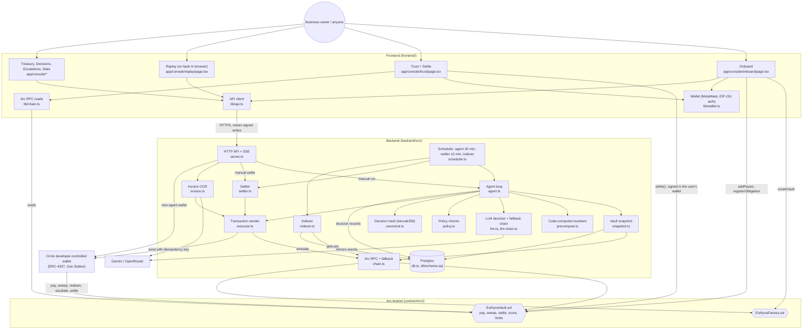
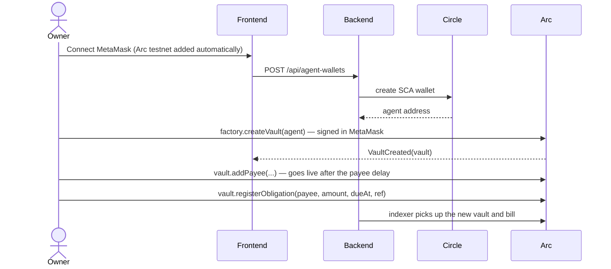
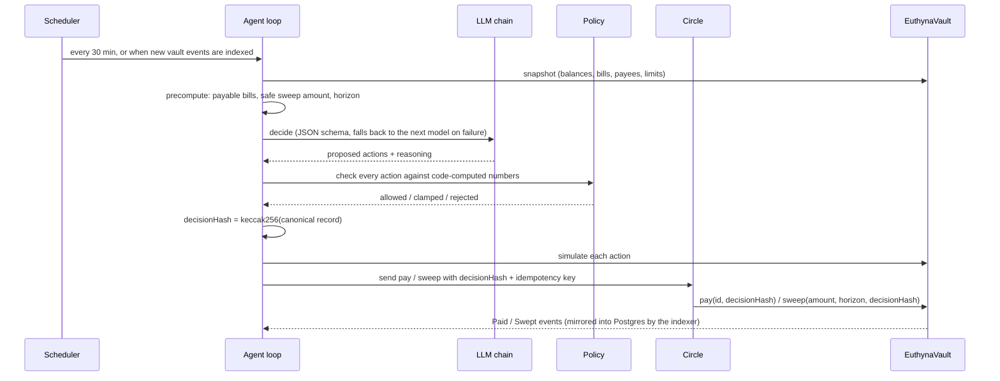
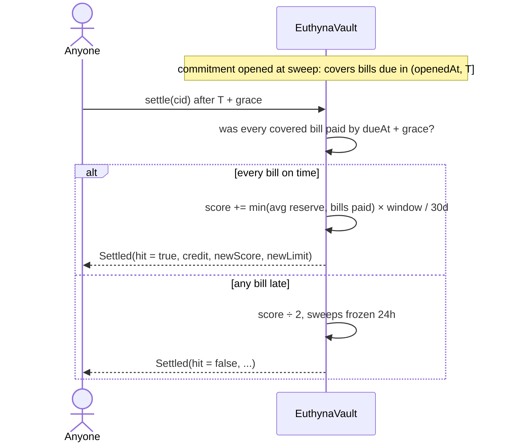

# Euthyna — An AI treasurer on probation

> **Tameion Agents Hackathon — Canteen × Circle, on Arc**
>
> *An AI agent that pays a small business's bills in USDC, whose spending limit lives in a smart contract
> and moves only with its own on-chain track record. Trust is earned, never configured.*

**Live app:** [euthynax.vercel.app](https://euthynax.vercel.app) ·
**Pitch:** [/pitch](https://euthynax.vercel.app/pitch) ·
**Docs:** [/docs](https://euthynax.vercel.app/docs) ·
**API:** [euthyna-np2i.onrender.com/api/stats](https://euthyna-np2i.onrender.com/api/stats)

---

## Deployed contracts

### Arc testnet (chain 5042002)

| Contract | Address |
|---|---|
| Production factory | [`0xD6846FB7BAD7F8CDba6eE8fB4b42D4e16A30d658`](https://testnet.arcscan.app/address/0xD6846FB7BAD7F8CDba6eE8fB4b42D4e16A30d658) |
| Production vault ("Euthyna") | [`0x0767f13610b794f1de85CEe78728114df1Ffa23d`](https://testnet.arcscan.app/address/0x0767f13610b794f1de85CEe78728114df1Ffa23d) |
| Second vault ("Euthyna Infra & API Costs") | [`0xc5A7E94bd82a479Da2AFAa65B2147666f4Abf142`](https://testnet.arcscan.app/address/0xc5A7E94bd82a479Da2AFAa65B2147666f4Abf142) |
| Test factory (short parameters) | [`0xffe19C5eBb3A8c70546B4bD033f54e89dc807438`](https://testnet.arcscan.app/address/0xffe19C5eBb3A8c70546B4bD033f54e89dc807438) |
| Test vault with the settled hit | [`0x4a08A58be01B5311D36EF4b042AA83BF738cF2b5`](https://testnet.arcscan.app/address/0x4a08A58be01B5311D36EF4b042AA83BF738cF2b5) |
| USDC (Arc native) | `0x3600000000000000000000000000000000000000` |

> Explorer: [testnet.arcscan.app](https://testnet.arcscan.app). Source code is in `contract/src/` and deployment
> records are in `contract/broadcast/`.

---

## Where the agent lives

The AI agent is in [`backend/src/`](backend/src/). One run of the agent goes through these files, in order:

| Step | File | What it does |
|---|---|---|
| **Loop** | [`agent.ts`](backend/src/agent.ts) | One full run: snapshot → decide → check → hash → execute |
| **Perceive** | [`snapshot.ts`](backend/src/snapshot.ts) | Reads the vault's state from the chain and the database |
| **Ground truth** | [`precompute.ts`](backend/src/precompute.ts) | Code computes every number the model can't override: payable bills, bills that must be escalated, sweep horizons, whether a sweep is allowed |
| **Reason** | [`llm.ts`](backend/src/llm.ts), [`llm-chain.ts`](backend/src/llm-chain.ts) | The LLM proposes actions as schema-checked JSON, falling back across free models |
| **Guardrails** | [`policy.ts`](backend/src/policy.ts) | Rejects or clamps any action outside the rules ([12 tests](backend/src/policy.test.ts)) |
| **Record** | [`canonical.ts`](backend/src/canonical.ts) | Hashes the full decision (keccak256) before any money moves |
| **Act** | [`executor.ts`](backend/src/executor.ts) | Simulates, then sends through the agent's Circle smart-contract wallet |
| **Narrate** | [`events.ts`](backend/src/events.ts) | Streams each stage live over SSE |
| **Wake up** | [`scheduler.ts`](backend/src/scheduler.ts) | Runs the agent every 30 minutes and when new vault events arrive |

Around it: [`settler.ts`](backend/src/settler.ts) settles matured commitments, [`indexer.ts`](backend/src/indexer.ts)
mirrors chain events into Postgres, and [`invoice.ts`](backend/src/invoice.ts) turns an invoice image into a bill.

The **judge** is not part of the agent: [`EuthynaVault.sol`](contract/src/EuthynaVault.sol) grades every promise the
agent makes, and the agent has no way to change its own score.

### How the agent works

**When it runs:** every 30 minutes, whenever new vault events are indexed (a new bill, a payee, a deposit), after
a commitment settles, or on demand. Only one run per vault at a time (a Postgres advisory lock), and before
deciding it reconciles any transaction a previous run left in flight, so a crash can't cause a double send.

**One run, step by step:**

1. **Perceive** ([`snapshot.ts`](backend/src/snapshot.ts)): reads liquid cash, reserve, floor, limits, open bills,
   payees, open commitments, past hits and misses, and expected inflows.
2. **Compute the ground truth** ([`precompute.ts`](backend/src/precompute.ts)): code works out which bills are
   payable now, which must go to the owner, the safe sweep amount for each horizon, and whether a sweep is
   allowed at all.
3. **Reason** ([`llm.ts`](backend/src/llm.ts)): the model gets that view and answers in schema-checked JSON with one or
   more actions (`pay`, `sweep`, `redeem`, `escalate` or `hold`), each with a reason, plus a confidence score. If a
   model fails or runs out of quota, the next one in the chain answers.
4. **Check** ([`policy.ts`](backend/src/policy.ts)): every proposal is tested against code-computed numbers and the
   contract's own rules, so a transaction that would fail is never sent.
   - A payment above the limit or daily cap is **converted** into an escalation to the owner.
   - A sweep is **clamped** to the safe amount and a 1-hour to 14-day horizon. One sweep per run, and never a
     redeem and a sweep together (no churn).
   - **Safety net:** any bill due within 2 hours is paid even if the model forgot it, pulling cash back from
     reserve if needed, and any over-limit bill is escalated so the owner sees it.
5. **Record** ([`canonical.ts`](backend/src/canonical.ts)): the full decision (snapshot, computed numbers, the model's
   output and every policy verdict) is hashed with keccak256 and stored.
6. **Act** ([`agent.ts`](backend/src/agent.ts), [`executor.ts`](backend/src/executor.ts)): in the order redeem → pay →
   escalate → sweep, each action is simulated, then sent through the agent's Circle wallet with the decision hash
   and an idempotency key. Each stage streams live over SSE.
7. **Get graded** ([`EuthynaVault.sol`](contract/src/EuthynaVault.sol)): every sweep is a promise. When its deadline
   passes, the contract grades it, and the agent's limit moves with the result.

**How it makes a treasury more efficient:**

- **Bills pay themselves.** Due bills are paid on time from the agent's wallet, with no manual payment runs. The
  owner only steps in for bills above the agent's limit.
- **It reacts in seconds.** A new bill triggers a run straight away; the agent's first production commitment was
  made right after a new bill was registered.
- **Cash goes where it's needed.** Spare cash above the floor and upcoming bills moves to reserve, and the agent
  pulls it back before paying when a bill needs it.
- **Approvals shrink as trust grows.** Every kept promise raises the autonomous limit, so over time fewer bills
  need the owner's approval. One miss halves the score, so a careless agent loses that freedom fast.
- **No wasted transactions.** Every action is simulated first, so nothing is sent that the contract would reject:
  0 failed actions so far.
- **Retries never pay twice.** Each action has an idempotency key derived from its decision, so a retry after a
  crash or timeout can't send the same payment again.
- **It keeps running.** If one AI model fails, the next answers; if the RPC fails, a fallback takes over; if the
  model forgets an urgent bill, the safety net pays it.

### How the agent performs

Measured on the real (non-test) vaults, as of 18 Oct 2026:

| Metric | Result |
|---|---|
| Decisions made on its own | **75**: 8 took action, 67 held (nothing due or no safe action) |
| On-chain actions sent | **9**, with **0 failures** |
| Decision → confirmed on-chain | **6.7 s** on average |
| One full run (snapshot → LLM → policy → hash → done) | **about 9 s** |
| Model proposals corrected by the policy layer | **29**, caught before reaching the chain |
| Models that answered | **5+**, switched automatically when one failed or hit its quota |
| Commitments graded by the contract | **1 hit, 0 misses** |
| Gas the agent has to hold | **none**: Circle Gas Station sponsors its transactions |

Every number can be checked against Arcscan, the public [`/api/stats`](https://euthyna-np2i.onrender.com/api/stats)
endpoint, and the agent's decision feed in the console.

```
euthyna/
├── backend/src/
│   ├── agent.ts          ◀ the agent loop
│   ├── snapshot.ts       ◀ perceive
│   ├── precompute.ts     ◀ ground truth
│   ├── llm.ts            ◀ reason
│   ├── llm-chain.ts      ◀ model fallback
│   ├── policy.ts         ◀ guardrails
│   ├── canonical.ts      ◀ decision hash
│   ├── executor.ts       ◀ act (Circle wallet)
│   ├── events.ts         ◀ live stream
│   ├── scheduler.ts      ◀ wake-up timer
│   ├── settler.ts, indexer.ts, invoice.ts, server.ts, …
└── contract/src/
    └── EuthynaVault.sol  ◀ the judge (scores the agent)
```

---

## Euthyna MCP server

Talk to Euthyna from any AI assistant. [`mcp/`](mcp/) is a [Model Context Protocol](https://modelcontextprotocol.io)
server (stdio and Streamable HTTP) for Claude Code, Claude Desktop, Cursor and other MCP clients. It is
read-only and holds no keys.

- **14 tools:** vault state, bills, payees, commitments (including when each can be settled), trust history,
  agent decisions, `verify_decision` (re-hashes a decision locally and checks it against the chain), and
  builders for unsigned `settle`, `addPayee` and `registerObligation` transactions.
- **Resources:** how-it-works docs, contract addresses, and `euthyna://vault/{address}` for any vault's live state.
- **Prompts:** `treasury_report`, `audit_decision`, `explain_trust`.

```bash
cd mcp && npm install
claude mcp add euthyna -- node "$(pwd)/dist/index.js"
```

Then ask: *"Has the Euthyna agent kept its promises? Verify its last decision that moved money."*
Setup for Claude Desktop, Cursor and HTTP: [mcp/README.md](mcp/README.md).

---

## 1. What is Euthyna?

Euthyna is a treasury agent for small businesses on Arc. It pays bills, keeps enough cash on hand for what's
coming due, and parks the rest in a reserve. What makes it different is **how much it's allowed to spend**:
that limit isn't a setting. It lives in the vault contract and moves only when the agent proves, on-chain,
that it kept its promises.

```
ONBOARD  →  The owner creates a vault, approves payees and registers bills, all from their own wallet
DECIDE   →  The agent snapshots the vault; code computes every number; an LLM proposes; policy checks
PAY      →  Bills are paid on time from the agent's Circle wallet, with a decision hash on-chain
COMMIT   →  Parking idle cash is a falsifiable promise: "every bill due before T is paid on time"
SETTLE   →  After T + grace, anyone calls settle(); the contract grades the promise from its own records
EARN     →  A hit raises the score and the autonomous limit; a miss halves the score
```

The name comes from the *euthyna*, the audit an Athenian official faced on leaving office: you held power,
now show your record.

---

## 2. The problem

**A limit is just a number someone typed.** AI agents get a spending limit from a config file. Nothing ties
it to how well the agent actually performs.

**Trust is all or nothing.** You either hand an agent the keys or have a human approve every payment. There's
no probation, no way to start small and grow, the way you would with a new hire.

**Agents grade their own homework.** Performance claims come from logs and dashboards the operator controls.
Nobody outside can check them.

Today, letting an AI agent move a business's money is a leap of faith, and the business carries all of the
risk.

---

## 3. The solution

Euthyna makes trust a **contract-enforced track record**.

| Piece | What it does |
|---|---|
| **Owner's vault** | USDC, payees and bills live in a contract the owner controls. The agent acts only through it. |
| **Allowlist only** | The agent has no function that sends money to an address of its choosing. New payees wait out a delay (1 hour on production vaults) before they can be paid. |
| **Every saving is a promise** | `sweep()` moves idle cash to reserve and opens a commitment: every bill due before `T` will be paid on time from liquid cash. |
| **Graded by the contract** | `settle()` is permissionless. After `T + grace` the contract checks its own records: hit or miss. |
| **Limit = track record** | `autonomousLimit = min(ownerCeiling, baseLimit + rate × score)`. A hit adds to the score linearly; a miss halves it and freezes sweeps for 24 hours. |
| **Every decision replayable** | The full decision record is hashed (keccak256) before any money moves, and the hash goes on-chain with the action. Anyone can re-hash it in their browser. |

**The model proposes, code checks every number, and the contract has the final word.**

### Scoring

| | |
|---|---|
| Autonomous limit | `min(ownerCeiling, baseLimit + rate × score)`; a new vault starts at 25 USDC |
| Daily cap | `min(ownerDailyCeiling, 3 × limit)` |
| Hit | `score += min(avg reserve held, owner bills paid on time in window) × window / 30 days` |
| Miss | `score ÷ 2`, sweeps frozen for 24 hours |
| Bills over the limit | escalated to the owner, who approves (paid from the vault) or cancels |

---

## 4. What makes it different

| | Pays bills itself | Limit enforced on-chain | Limit earned from results | Graded by a contract | Decisions replayable |
|---|---|---|---|---|---|
| AI payment agents | ✅ | — | — | — | — |
| Fixed spending caps (multisig, policy rules) | — | ✅ | fixed | — | — |
| Off-chain agent ratings | — | — | self-reported | — | — |
| **Euthyna** | ✅ | ✅ | ✅ | ✅ | ✅ |

- **Earned, not configured.** The only thing that raises the limit is a promise kept, checked by the contract.
- **Lost faster than earned.** Hits add a little; one miss halves the score. A reckless agent shrinks quickly.
- **Anyone can audit it.** `settle()` is permissionless and every decision hash is on-chain.
- **Closed loopholes.** The spec's 22 attacks (prompt injection, the agent adding payees, sweep-then-redeem,
  the agent writing its own exam, and more) are each closed in the contract or the policy layer; see the
  [loophole audit](docs/contract.md#loophole-audit).

---

## 5. How Arc and Circle power Euthyna

### Arc

| Feature | How Euthyna uses it |
|---|---|
| **USDC as gas** | Fees, bills and reserve are all USDC, so even small bills are cheap to pay and settle |
| **Fast finality** | Payments and settlements confirm quickly enough for the agent to act and verify in one run |
| **Arc USDC (`0x3600…`)** | The vault holds and pays native USDC through its ERC-20 interface |
| **RPC** | `rpc.testnet.arc.io`, with a Blockdaemon fallback and Multicall3-batched reads |

### Circle

| Feature | How Euthyna uses it |
|---|---|
| **Developer-controlled wallets** | The agent acts through a Circle wallet; self-serve onboarding creates a new agent wallet for each new vault |
| **Smart-contract accounts (ERC-4337)** | The agent signs as an SCA; owners sign in their own wallet, and the hosted backend never holds an owner key |
| **Gas Station** | Agent transactions are gas-sponsored |
| **Idempotency keys** | Each action uses a key derived from (decision id, index), so a retry can never pay twice |
| **Webhook endpoint** | `POST /webhooks/circle` nudges the indexer, so new transactions show up fast |

```typescript
// backend/src/agent.ts — every action carries the decision's hash and a deterministic idempotency key
const data = encodeAction(action, decisionHash); // pay / sweep / redeem / escalate, with decisionHash
const key = actionKey(decisionId, idx);          // uuidv5(`${decisionId}:${idx}`)
const r = await send({ to: vault, data, from: agentAddress, walletId, idempotencyKey: key });
```

---

## 6. Architecture

```
┌──────────────────────────── Owner / Browser ─────────────────────────────┐
│  Next.js 16 frontend (React 19, Tailwind v4)                             │
│  MetaMask (EIP-1193)  ── owner signs addPayee / registerObligation / ... │
│  EIP-191 owner auth   ── signed header for owner-only API routes         │
│  Replay page          ── re-hashes decision records in the browser       │
│  Trust page           ── anyone can call settle() on a matured promise   │
└───────────────────────────────────┬──────────────────────────────────────┘
                                    │ HTTPS + SSE
                                    ▼
┌──────────────────────── Backend (Node + TypeScript) ─────────────────────┐
│  Agent loop    snapshot → precompute → LLM → policy → hash → execute     │
│  Settler       settles matured commitments every 10 min                  │
│  Indexer       mirrors vault + factory events into Postgres              │
│  HTTP API      public reads, owner-signed writes, SSE live stream        │
│  LLM chain     free models, Gemini first with OpenRouter as fallback     │
└──────────┬──────────────────────────┬────────────────────────┬──────────┘
           │ Circle W3S API            │ Postgres (Supabase)    │ Arc RPC
           ▼                           ▼                        ▼
┌─────────────────────┐   ┌───────────────────────┐   ┌──────────────────────────┐
│ Agent SCA wallet    │   │ decisions, actions,   │   │ EuthynaFactory           │
│ (ERC-4337, Gas      │   │ obligations, payees,  │   │ EuthynaVault (per vault) │
│  Station sponsored) │   │ commitments, events   │   │ USDC                     │
└─────────────────────┘   └───────────────────────┘   └──────────────────────────┘
```

### Code map

Every box is a real file; every arrow is a call or transaction that exists in the code.



---

## 7. Sequence flows

### Onboarding



### One agent run



### Settlement



---

## 8. Smart contracts

Two Solidity contracts (Foundry, OpenZeppelin), deployed on Arc testnet.

### EuthynaVault.sol

```solidity
// Owner
function addPayee(address p, uint128 maxPerInvoice, uint128 maxPerMonth) external;  // live after payeeDelay
function registerObligation(address payee, uint128 amount, uint64 dueAt, bytes32 ref) external;
function cancelObligation(uint32 id) external;
function approveEscalation(uint32 id) external;           // pays an escalated bill from the vault
function setCeilings(uint128 ownerCeiling, uint128 ownerDailyCeiling) external;
function setAgent(address agent) external;                 // replace or revoke the agent
function withdraw(uint128 amount) external;

// Agent
function pay(uint32 id, bytes32 decisionHash) external;                        // allowlisted payee only
function sweep(uint128 amount, uint64 horizon, bytes32 decisionHash) external; // opens a commitment
function redeem(uint128 amount, bytes32 decisionHash) external;
function escalate(uint32 id, bytes32 decisionHash) external;                   // only if over limit/cap
function agentRegisterObligation(address payee, uint128 amount, uint64 dueAt, bytes32 ref, bytes32 decisionHash) external;

// Anyone
function settle(uint32 cid) external;                      // grades a commitment after T + grace
function materializeRecurring(uint32 rid) external returns (uint32);

// Views
function autonomousLimit() external view returns (uint256);
function dailyCap() external view returns (uint256);
function liquid() external view returns (uint256);
function getCommitment(uint32 cid) external view returns (Commitment memory);
```

**Commitment lifecycle**

```
OPEN (sweep) ──▶ T passes ──▶ T + grace ──▶ settle() ──▶ HIT  (score up, limit up)
                                                    └──▶ MISS (score ÷ 2, sweeps frozen 24h)
```

Limits: at most 5 open commitments; horizon up to 14 days, with a minimum horizon of 1 hour on production
vaults. The deployed production vaults enforce that minimum as the constant `MIN_HORIZON` (3600 s) and use a
1-hour payee delay; the current source makes the minimum a per-vault parameter (`minHorizon`, ≥ 1 minute).

### EuthynaFactory.sol

Creates a vault for an owner and an agent with the factory's default parameters, and indexes vaults by owner.
The current source also adds `createVaultWithParams` for custom parameters; the deployed factories predate it.

Details: [docs/contract.md](docs/contract.md). 38 Foundry tests, plus 2 fork tests that run with
`ARC_RPC_URL` set.

---

## 9. Status

Every claim here can be checked on [Arcscan](https://testnet.arcscan.app) or against the
[live API](https://euthyna-np2i.onrender.com/api/stats).

### Proven on-chain

- **The agent's first real commitment settled as a hit, on the production vault.** At 15:22 IST on 17 Oct
  the agent, on its own, paid a 5 USDC bill and swept 14 USDC into reserve for 6 hours (decision
  `0x2da5…836e`). At 22:32 IST `settle()` graded it a **hit**: score 0 → 0.083333, autonomous limit
  25.00 → 25.166666 USDC. Settle tx
  [`0x2051…31b4`](https://testnet.arcscan.app/tx/0x20510e7b5eb69b0cb702d60fdc9978c4dd1f9987fac74a4f2a53bf64f01c31b4).
  `settle()` is permissionless; the contract grades the commitment from its own records.
- **Autonomous payments:** 8 bills, 49.10 USDC, to 5 distinct payees, all decided and sent by the agent
  through its Circle smart-contract wallet. The first was
  [`0x791f…0876`](https://testnet.arcscan.app/tx/0x791f71d1c955a8ca57c0b6c60692ae85dee09bf6f3cef135c96486283ba30876).
- **Both outcomes demonstrated on a test vault** (`0x4a08…F2b5`, short parameters): its Trust chart steps
  up, then down.
  - **Hit:** the agent swept 1 USDC against a bill, paid it on time, and `settle()` graded a hit: score
    0 → 0.008333, limit 25.00 → 25.016666 USDC. Settle tx
    [`0x2186…d5f1`](https://testnet.arcscan.app/tx/0x218692358b25492f59c4958b3960f9688ded4239473263809e5024d0d909d5f1).
  - **Miss (engineered):** a commitment was staged over a bill that was deliberately left unpaid.
    `settle()` graded it a miss: score 0.008333 → 0.004166 (halved), limit 25.016666 → 25.008332 USDC,
    sweeps frozen for 24 hours. Sweep
    [`0x31ba…2427`](https://testnet.arcscan.app/tx/0x31ba5943f9d5e7e300f894674f54b96120a08820bb2a41e12bb51c2dc1722427),
    settle [`0xe474…b3e2`](https://testnet.arcscan.app/tx/0xe474bc08c6dfaff1267eeecb7580b41035d86b8742a36aee1a0c93910365b3e2).
    The script and its record are in [`backend/scripts/`](backend/scripts/demo-miss.ts).
- **Self-serve onboarding from MetaMask:** a vault was created, a payee added and a bill registered entirely
  from the browser wallet, and the agent paid it
  ([`0x4df9…da0b`](https://testnet.arcscan.app/tx/0x4df93f2b6e5c24c37997bdaf2edfcd353f9b75802a3e0b13bc2b9fbb78a8da0b)).
- **The policy layer at work:** 29 model-proposed actions clamped or rejected before reaching the chain
  (as of 18 Oct), catching the model when it was wrong. Live count in `/api/stats`.
- **Every decision is replayable:** hashed before any money moves, with the hash emitted on-chain alongside
  the action and re-verified in the browser on the Replay page.

### Public numbers

`/api/stats` reports real (non-test) vaults only: bills paid by the agent, USDC paid, distinct payees,
commitments, hits and misses, and policy interventions. Test vaults (`0x82a9…2692`, `0x4a08…F2b5`,
`0xAd91…0a5f`, `0xB656…3C68`, `0xdeab…5764`) are excluded.

### Components

| Piece | Status |
|---|---|
| Vault: pay / sweep / redeem / settle | ✅ deployed on Arc testnet, viewable on Arcscan; 38 Foundry tests |
| Score → autonomous limit | ✅ enforced entirely in the contract; hit and miss both settled on-chain |
| Agent loop (snapshot → decide → policy → execute) | ✅ every 30 min and on events; 12/12 policy tests |
| Payments through a Circle SCA wallet | ✅ verified end to end (Gas Station-sponsored, ERC-4337) |
| Decision hash + replay | ✅ re-hashed in the viewer's browser and checked against the stored, recomputed and on-chain hashes |
| Permissionless settle from the UI | ✅ Trust page: countdown, then a Settle button for any connected wallet |
| Live reasoning stream | ✅ SSE at `/api/vaults/:id/live` |
| LLM | ✅ automatic fallback chain of free models (Gemini first, OpenRouter as fallback); the record names the model that answered |
| Invoice OCR | ✅ vision extraction and exact payee matching, verified live ([`0x4d61…0462`](https://testnet.arcscan.app/tx/0x4d614e69748dfcf6d41578506af8f857230a2189ce41373004e7f9b43a360462)) |
| Loophole audit | ✅ all 22 attack scenarios closed in the contract or policy layer |
| Frontend | ✅ landing, pitch deck, docs and 7 console pages on live data, with MetaMask; responsive on mobile |
| Hosting | ✅ backend on Render, frontend on Vercel |

---

## 10. Tech stack

| Layer | Technology |
|---|---|
| Smart contracts | Solidity · Foundry · OpenZeppelin |
| Chain | Arc testnet (chain 5042002) · native USDC |
| Agent wallet | Circle developer-controlled wallets (SCA, ERC-4337) · Gas Station |
| Backend | Node.js · Express 5 · TypeScript · viem · zod |
| Database | Postgres (Supabase) |
| LLM | Gemini and OpenRouter (OpenAI-compatible) with an automatic fallback chain; Anthropic and xAI supported |
| Frontend | Next.js 16 · React 19 · Tailwind CSS v4 · viem |
| Owner wallet | MetaMask (EIP-1193) · EIP-191 signed owner actions |
| Hosting | Render (backend) · Vercel (frontend) |

---

## 11. Repository structure

```
euthyna/
├── README.md
├── render.yaml                   # Render Blueprint for the backend
│
├── contract/                     # Foundry
│   ├── src/
│   │   ├── EuthynaVault.sol      # pay, sweep, settle, scoring, limits
│   │   └── EuthynaFactory.sol    # creates vaults, indexes them by owner
│   ├── test/                     # EuthynaVault.t.sol, ArcFork.t.sol
│   └── script/Deploy.s.sol
│
├── backend/
│   ├── src/
│   │   ├── agent.ts              # the agent loop: decide, hash, execute
│   │   ├── llm.ts, llm-chain.ts  # model calls + automatic fallback chain
│   │   ├── policy.ts             # checks every proposed action (12 tests)
│   │   ├── precompute.ts         # code-computed numbers the model can't override
│   │   ├── snapshot.ts           # vault state for a decision
│   │   ├── settler.ts            # settles matured commitments
│   │   ├── indexer.ts            # mirrors chain events into Postgres
│   │   ├── executor.ts           # Circle (or local) transaction sender
│   │   ├── invoice.ts            # invoice OCR → registered bill
│   │   └── server.ts             # HTTP API + SSE
│   ├── db/schema.sql
│   └── scripts/                  # setup-circle, create-agent-wallet, onboard, smoke, e2e-local, demo-miss, …
│
├── frontend/
│   ├── app/
│   │   ├── page.tsx              # landing: orbit hero, live stats, live businesses
│   │   ├── pitch/                # 6-slide deck (F for fullscreen)
│   │   ├── docs/                 # in-app documentation
│   │   └── console/              # treasury, trust, decisions, replay, escalations, onboard, stats
│   ├── components/
│   └── lib/                      # api client, wallet, chain, ABIs
│
├── mcp/                          # MCP server: Euthyna tools for any AI assistant
│   ├── src/server.ts             # tools, resources and prompts
│   └── src/index.ts              # stdio and Streamable HTTP transports
│
└── docs/
    ├── contract.md               # mechanism, scoring, loophole audit, addresses
    ├── backend.md                # agent loop, LLM chain, setup, API reference
    ├── frontend.md               # pages, wallets, running and deploying
    ├── design.md                 # the UI design system
    └── onboarding.md             # 5-minute guide for a new business
```

---

## 12. Local development

### Prerequisites

- [Foundry](https://getfoundry.sh), Node.js 20+
- A Supabase (Postgres) project
- A Circle developer account (testnet API key)
- A key for one LLM provider (a free Gemini key works)

### 1. Contracts

```bash
git submodule update --init --recursive
cd contract && forge build && forge test
```

### 2. Backend

```bash
cd backend
npm install
cp .env.example .env            # fill it in; see docs/backend.md
npm run db:migrate              # applies db/schema.sql
npm run setup:circle            # first run prints an entity secret; second run registers it
npm run create-wallet           # agent SCA wallet
npm start                       # API on :8787 + agent / settler / indexer loops
```

### 3. Frontend

```bash
cd frontend
npm install
NEXT_PUBLIC_API_URL=http://127.0.0.1:8787 npm run dev   # http://localhost:3000
```

### 4. Try the flow

1. **Get test USDC** at [faucet.circle.com](https://faucet.circle.com) (Arc Testnet).
2. **Onboard:** open `/console/onboard`, connect MetaMask, create a vault, add a payee and a bill (due after the
   payee goes live; the page suggests one hour after).
3. **Fund the vault** with test USDC.
4. **Watch the agent:** Decisions shows each run, Replay re-verifies its hash, Trust shows commitments.
5. **Settle:** when a commitment's countdown ends, press Settle on the Trust page and watch the contract grade
   it.

---

## 13. Links

| Resource | URL |
|---|---|
| Live app | https://euthynax.vercel.app |
| Pitch deck | https://euthynax.vercel.app/pitch |
| Docs | https://euthynax.vercel.app/docs |
| Public API | https://euthyna-np2i.onrender.com/api/stats |
| Arcscan (testnet) | https://testnet.arcscan.app |
| Circle faucet | https://faucet.circle.com |
| Circle developer docs | https://developers.circle.com |

---

## Acknowledgements

- **Arc**: the chain, with USDC as gas
- **Circle**: developer-controlled wallets, Gas Station, USDC
- **Canteen**: the Tameion hackathon
- [Foundry](https://getfoundry.sh) and [OpenZeppelin](https://openzeppelin.com): contract tooling and libraries

---

*Built for the Tameion Agents Hackathon (Canteen × Circle, on Arc) · October 2026*
